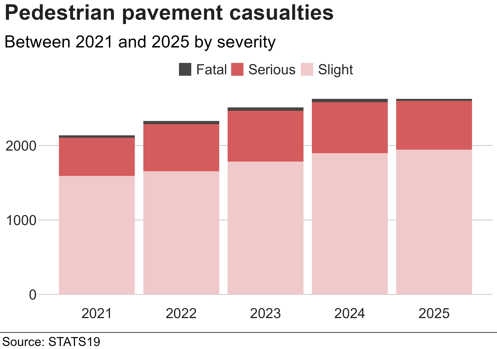
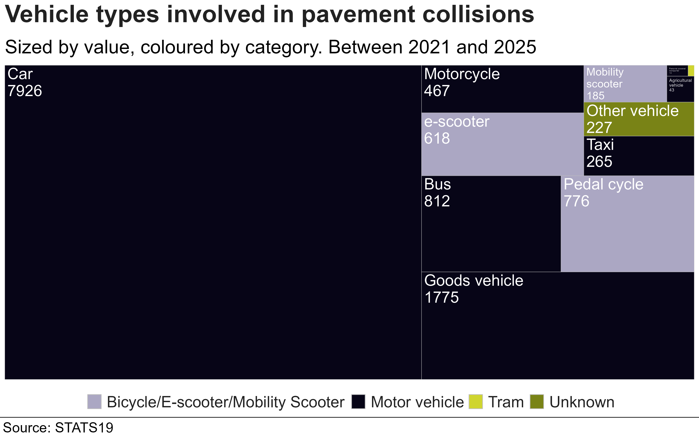
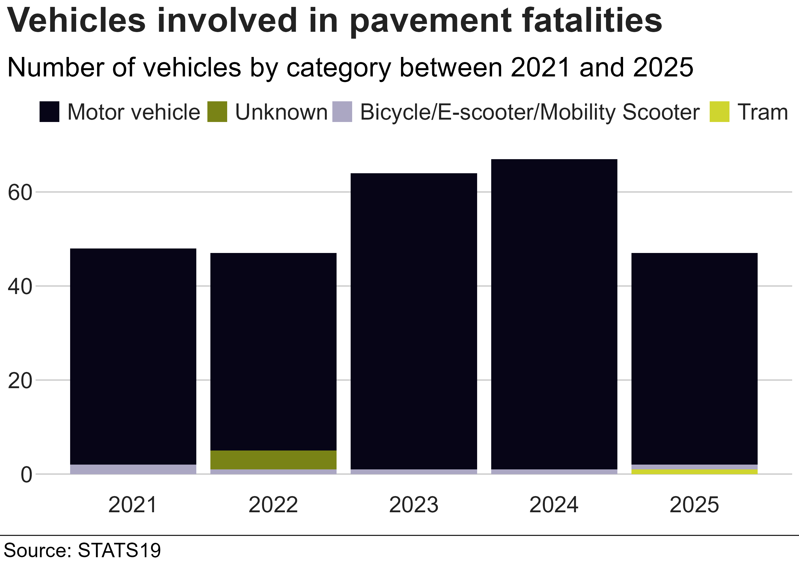
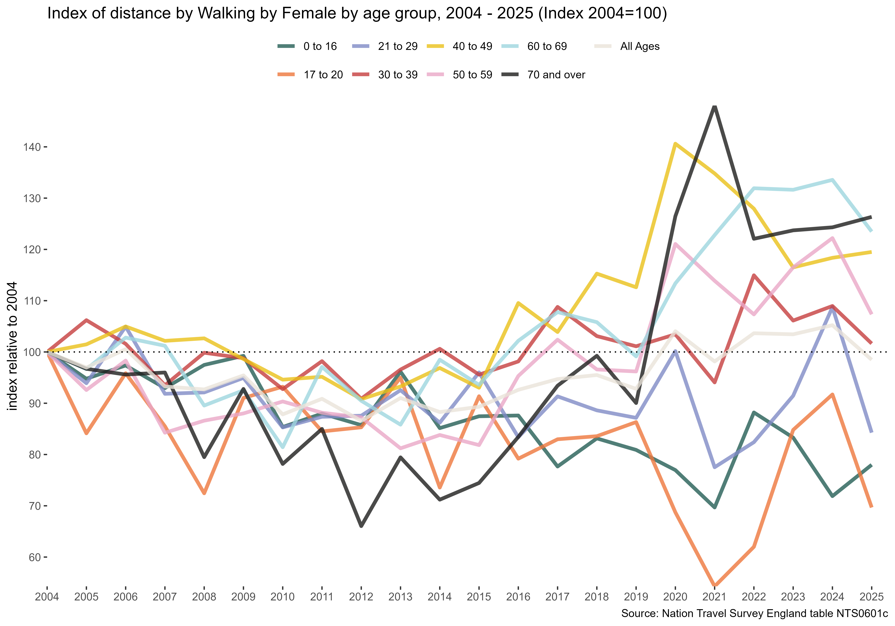
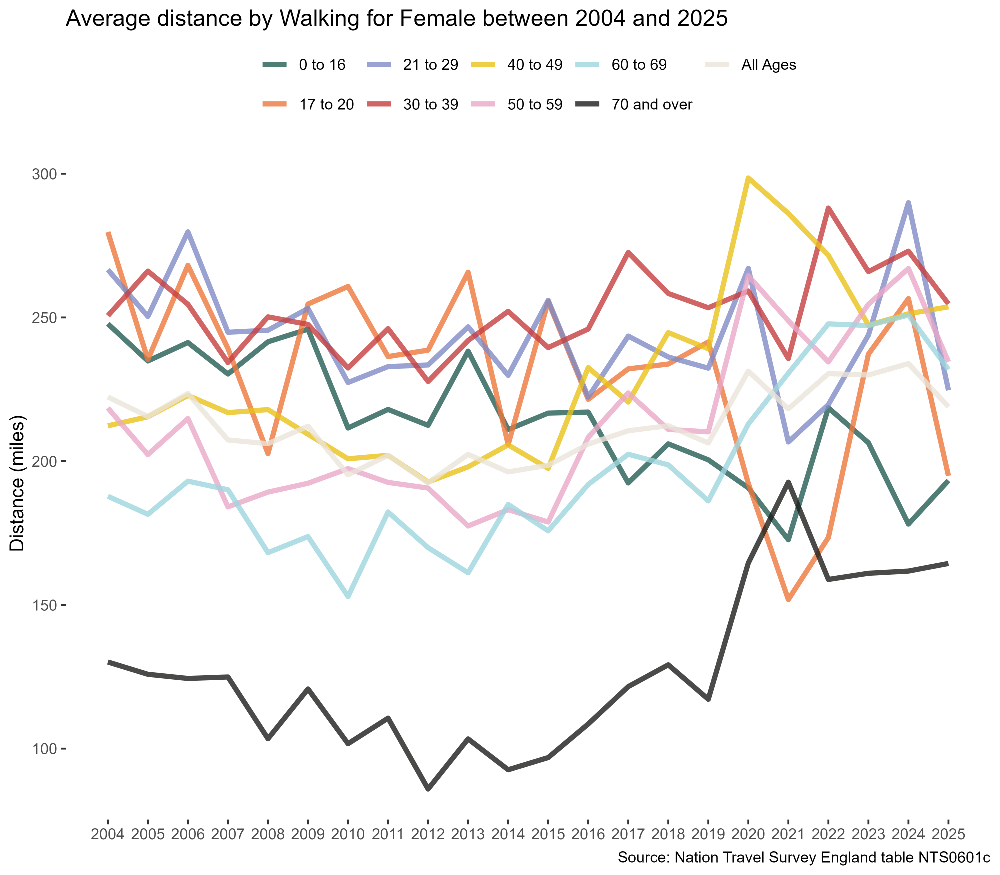
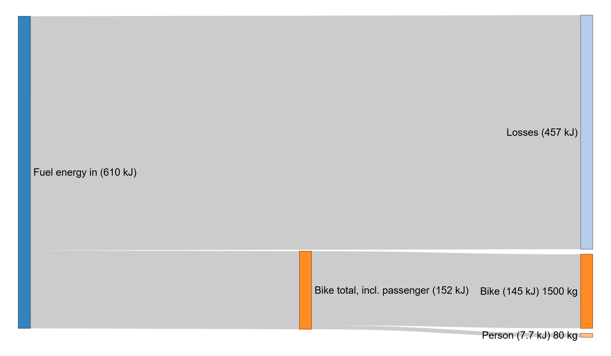

Code to produce numbers and plots used in article for the Urban Cycling Institute (UCI) on Pavement deaths in Great Britain.

Download and install R and Studio. Opening a .R file in Rstudio will prompt installation of packages and on accepting will install, the scripts should then be able to be run.

Grateful to anyone who spots any errors/has improvements. Please raise an issue in this repo.

## STATS19



## National travel survey plots
nts_plots.R downloads the national travel survey data and generates the plots for all categories. In this case the interest was younger person female walking rates.

## Homicide rates vs STATS19
ons_homicide.R downloads the ONS homicide rates and produces the street crime data and also recalculates STATS19 data only including England and Wales and for the same period as the crime data, which is April to March of each year.

## Energy 
### Sankey
sankey.R creates a diagram showing the kinetic energy needed to move a 1500kg car and 80kg person plus the chemical energy needed to do so with a 25% efficient internal combustion engine. Can be adjusted for different vehicles, persons and efficiencies.

### Interactive calculator
energy_transport_shiny.R is a shiny app that enables interactive inputs of data and creation of vehicles.
https://blaisekelly.github.io/me/nrg_transport.html

